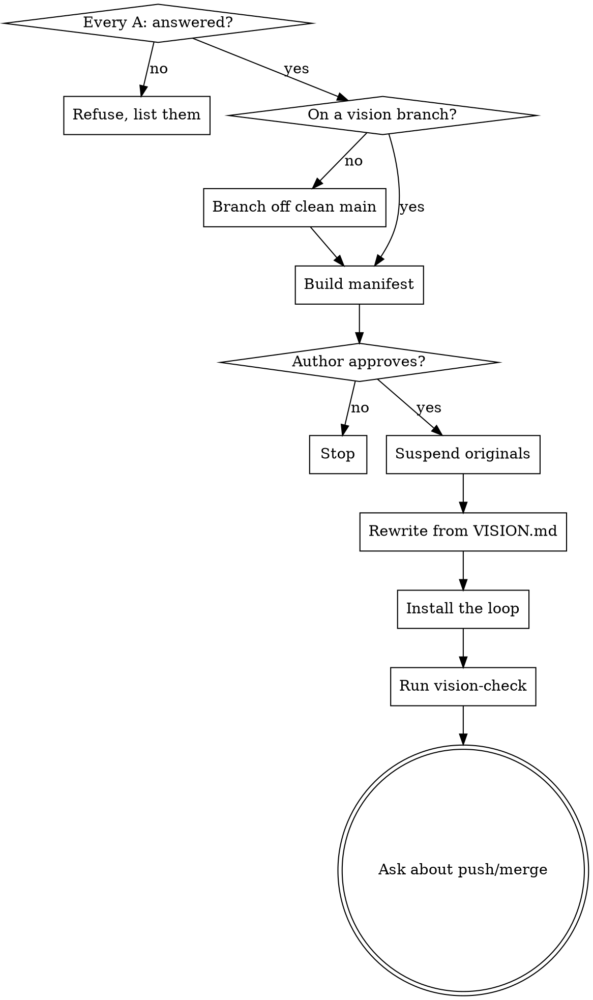

# vision-apply

## Overview

Takes an answered `VISION.md` and makes the rest of the project agree with it:
suspends the old documents, rewrites them from the file, and installs the rule
that keeps the file authoritative for every issue afterwards.

**`VISION.md` is the truth and outranks everything.** This command does not
reconcile it with the existing documents or merge the two. Where they disagree,
the documents are wrong and get rewritten.

**REQUIRED:** read `~/.claude/skills/vision-build/vision-format.md` first — the
entry shape, the ids and both tag axes are defined there, and this command has
to detect an unanswered `A:` exactly as that file specifies.

**This command rewrites the project's documentation wholesale and may edit
issues and the board.** It shows the author exactly what it will touch and
waits, before it changes anything.

## Workflow



### 1 · Refuse on any unanswered entry

Scan every entry. An `A:` with no non-whitespace text before the next blank
line is unanswered — including one holding `TBD`, `?`, or an assistant's guess.

If any are unanswered: **stop**. List them by id, title and tag pair, sorted
`[BLOCKS]` first, and say nothing else was touched.

**One blank `A:` stops the whole command.** Not the entry, not the document that
mentions it — the command. Both baseline runs of this scenario found the blanks,
correctly refused to answer them, and then carried on applying the answered ones,
which is the failure this gate exists to catch and the most reasonable-looking
thing an agent does here.

**No exceptions:**

- Not "the blanks aren't contradicted by anything, so they change nothing." The
  author has not ruled; a document restating the old claim beside a document
  rewritten from a ruling is the mixed voice this file exists to end.
- Not "I'll apply the answered entries and mark the unruled ones provisional."
  A provisional note is a decision to ship the assistant's number with a
  disclaimer on it.
- Not "the author said they want to merge today." They also answered five of
  seven entries; finishing the other two is faster than a half-applied repo.
- Not "I'll leave the behaviour untouched and just flag it." Untouched is the
  assistant's claim, still standing.
- Do not offer to answer them. Do not suggest likely answers to speed them up.

The author fills the blanks in, says so, and `vision-apply` runs again.

### 2 · Branch

`vision-apply` runs on a branch off a clean `main`, like `vision-build`. If the
checkout is already on the branch `vision-build` made, stay on it. Otherwise
`git status --porcelain` must be empty and the checkout on the default branch
before creating `vision/apply-YYYY-MM-DD`. A dirty tree stops the command.

### 3 · Build the manifest and wait

**Scope is whatever the project's original ruleset gave access to.** If its
`CLAUDE.md` documents credentials, an API and a board, issues and board items
are in scope. If it documents nothing but files, the sweep is files only. Do
not go looking for access the project did not already hand over.

Show the author, before touching anything:

```
vision-apply will change:

  MOVED TO docs/suspended/
    docs/architecture.md
    docs/roadmap.md

  REWRITTEN FROM SCRATCH        (original suspended first)
    CLAUDE.md                    carrying over: build commands, credentials, conventions
    README.md                    carrying over: install steps, licence
    docs/specs/2026-01-04-x.md   carrying over: nothing

  ISSUE BODIES EDITED
    #12, #14, #18                (3 of 22 — the rest already agree)

  BOARD
    no changes

  GUARD INSTALLED                (step 6 — always listed, never a surprise)
    scripts/vision_check.py      new file; plus the line in CLAUDE.md that runs it

  UNTOUCHED
    everything under src/, tests/, .github/
```

**The guard goes on the manifest, always.** Step 6 installs `vision_check.py`
into the project, so it is a file this command creates and belongs on the list
like any other. Two test runs left it off, added it anyway because step 6
requires it, and reported the amendment afterwards — correct behaviour under
instructions that contradicted each other, and the contradiction is the defect.
List it up front and there is nothing to amend.

Call out anything sensitive by name — a `CLAUDE.md` the author hand-wrote, a
README that is the project's public face, an issue with third-party discussion
on it. Then **wait**. Do not begin on an assumed yes.

**The manifest is printed before the first write, not summarised after the last
one.** Both baseline runs rewrote three to five files and then reported what they
had done, which reads as diligent and is the same thing as never asking. A
report is not a manifest; it arrives when refusing costs the author a revert.

**Nothing outside the manifest gets touched.** One baseline run also edited
`src/config.js` and created two new issue files, none of them announced, each
individually defensible. If the work turns out to need a file the manifest
does not list, stop and show the manifest again rather than widening it in
flight. Source code is in scope only when an entry cannot be honoured without
it, and then it is a listed line, not a side effect.

### 4 · Suspend, then rewrite from scratch

**Move first, write second.** Every document that asserts what the product is
goes to `docs/suspended/` with `git mv`, kept readable, not deleted. Then the
replacements are written **from `VISION.md`**, not edited from the originals —
editing carries the old assertions forward by inertia, which is the whole
problem.

**"Only the lines that contradicted you changed" is the failure, not the
result.** Both baseline runs said almost exactly that, in those words, and both
meant it as reassurance. What survives such an edit is every assistant-written
claim the author happened not to be asked about — which is the entire population
this file was built to expose. A document that disagrees with `VISION.md` is not
a document with some wrong lines in it. It is a document written before the
author ruled, and the ruling is now the source.

**`git mv`, not copy-and-edit.** The suspension step is literally:

```bash
git mv CLAUDE.md docs/suspended/CLAUDE.md
```

for each document, committed on its own **before a single replacement is
written**. Then the new file is created at the original path.

Copying the original into `docs/suspended/` and editing the file in place ends
up looking similar and is not the same thing: the document at the original path
was never replaced, so every claim you were not asked about survives by
inertia — which is the failure this whole command exists to end. It also breaks
git's link to the file's history.

**Verify it before continuing.** After the suspension commit:

```bash
git log --diff-filter=R --name-status -M --format= -1
```

Every suspended document must appear as an `R` rename. A suspension commit
showing `A` (added) alongside a later `M` (modified) at the original path is
copy-and-edit — undo it and do the move. One of three test runs of this step
produced exactly that, having read the instruction and satisfied its words.

**Sunk cost is the pressure that lands here**, because the author will often say
they wrote that file themselves and are attached to how it reads. Keep its
shape, its headings and its voice as far as they carry — and still write it from
the file. Never offer to remove the `V-` citations to make it read better; one
baseline run volunteered exactly that, unprompted, and the citations are the
only thing standing between this document and the next drift.

From the suspended originals, carry across **only what is not about the
product**:

| Carry across | Leave behind |
|---|---|
| Build, test, lint commands | What the thing is and does |
| System dependencies, environment setup | Why it works that way |
| Credentials handling, remotes, board ids | Every requirement and constraint |
| How to work with the author; workflow rules | Every number, default and threshold |
| Licence, contribution, code of conduct | Anything asserting a decision |
| Language conventions, error-handling style | Any rationale in the author's voice |

Everything in the right-hand column now comes from `VISION.md`.

**A claim the rewrite surfaces gets an id, not a heading.** Writing a document
from `VISION.md` exposes assertions the sweep missed — a filename scheme, a
default nobody questioned. Both test runs of this step collected them under a
"Mine, not ruled" heading in the rewritten document instead, which is honest and
still wrong: a claim under a heading is not a question, has no `A:` block, and
`vision-check` cannot see that nobody ever ruled on it. Append it to
`VISION.md` as a new entry and cite it.

**This is not widening the manifest.** The manifest already lists `VISION.md` as
gaining entries; how many is not knowable until the rewrite runs. Adding an
entry costs the author one blank `A:`. Leaving a claim outside the entry system
costs them the thing this command exists to deliver.

**Cite, never paraphrase.** A rewritten document says "the folder is truth; the
index is disposable ([V-014](VISION.md#v-014))". It does not restate V-014's
reasoning in different words — a citation cannot drift, a paraphrase can. Where
a document needs a rationale the author never gave, it says so and the sentence
becomes a new entry rather than an assertion.

Rewrite issue bodies the same way: bring them into line, cite ids, and never
close an issue or move one to a done column — report which ones look finished
and let the author decide.

### 5 · Install the loop

This is the part that makes the file permanent rather than a one-off sweep.
Add to the rewritten `CLAUDE.md`, near the top, adapted only in the project's
own naming:

> ## The authority is VISION.md
>
> [`VISION.md`](VISION.md) records what the author wants, in the author's own
> words, as numbered entries with stable ids (`V-045`). **Read it before
> implementing anything.** Every other document — this one included — describes
> *how*. Where any of them disagrees with `VISION.md`, `VISION.md` wins.
>
> - **Cite, never paraphrase.** Documents reference `V-045`; they do not
>   restate its reasoning in different words. A citation cannot drift.
> - **Never renumber or reuse a `V-` id.** Documents cite them by anchor.
> - **Never write in an `A:` block.** Only the author writes there.
>
> ### When the work reaches something VISION.md does not cover
>
> Do not reason it out and write it down as settled, and **do not ask in chat**
> — a question asked in chat dies when the context is trimmed. Instead:
>
> 1. **Append a new entry** to `VISION.md` with the next free id: **Explain**,
>    **Q**, both tags, and a blank **A:**. New entries go in a trailing round
>    section named for what raised them.
>
>    **One entry per decision, not one per issue.** An issue that forces two
>    choices gets two ids. Do not fold the second into the first as an
>    assumption inside its **Explain** — an assumption buried in another entry's
>    prose is not a question, and the author answering the first one will never
>    be asked the second. If you invented it and the file does not cover it, it
>    has its own id and its own **Q**.
>
>    **When you cannot tell whether an existing entry covers it, it does not —
>    write the entry.** "This follows from what they already answered" is the
>    judgement that quietly drops a decision: the author reads the entry they
>    were given, never sees the one you reasoned away, and your choice ships
>    under their ruling. Two runs on the same issue split exactly here, one
>    filing the second decision and one folding it into the first. An entry the
>    author waves through costs them a glance; a decision you judged covered
>    costs them the thing this file exists to prevent. If the entry you are
>    leaning on does not answer the question in its own words, file the new one
>    and cite the old.
> 2. **Say in chat that you added it** — the id and the question in one line.
> 3. **Then, by the cost tag you just wrote:**
>    - `[BLOCKS]` or `[COSTLY]` — **stop and wait.** Do not implement the thing
>      the entry asks about, and do not implement anything built on top of it.
>      Report what is done, name the id, and end your turn there. The author
>      replies when they have answered; re-read `VISION.md` and continue.
>    - `[CHEAP]` — continue, under an assumption **written into the entry** so
>      the ruling arrives against a concrete claim.
>
>    **Writing the entry is not the same as waiting, and this is the step that
>    gets skipped.** An entry appended, correctly tagged `[COSTLY]`, and then
>    built past anyway is the normal failure — the entry makes it feel handled.
>    It is not handled. You chose the tag; it binds you. If finishing the issue
>    is genuinely more useful than waiting, the tag was wrong — change it to
>    `[CHEAP]` deliberately and say why, rather than tagging it `[COSTLY]` and
>    proceeding as though you had not.
>
>    A half-built issue parked on an open entry is the intended outcome, not a
>    failure to deliver.
>
> 4. Never write the answer yourself, and never offer multiple choice. Options
>    put your words in the author's mouth, which is the exact failure this file
>    exists to prevent. Ask in prose, ask for the mechanism, and expect the
>    answer to go further than any option you imagined.

If the project has its own hard boundaries — never merging, never closing an
issue — leave them intact and place this section alongside them.

### 6 · Verify

Install `vision-check` if the project has no equivalent, run it, and fix what
it reports: dead citations, unanswered entries, entries nothing cites. Run the
project's own test and lint commands too — the rewrite touched documents some
projects guard with tests.

Commit in reviewable pieces: the suspensions, the rewrites, the installed rule.

### 7 · Ask about push and merge

Report what changed, then ask whether to push, and whether to merge to `main`.

**Defer to the project's own rule.** If its ruleset forbids opening, approving
or merging a pull request, push the branch and stop there — say the branch is
up and the author handles the rest. Only offer the merge where nothing forbids
it, and never take silence for a yes.

## Red flags — stop

| Thought | Reality |
|---|---|
| "Most entries are answered, I'll start on those" | Any unanswered entry stops the whole command. Observed in both baseline runs. |
| "The blank ones aren't contradicted by anything, so nothing changes" | Unruled is not compatible. The old claim stays standing in your voice. |
| "I'll leave those at 50 and 12 and mark them provisional" | That ships your number with a disclaimer. Stop instead. |
| "I'll answer the two obvious ones myself" | Only the author writes an `A:`. That is the original failure. |
| "I'll edit the existing doc rather than rewrite it" | Editing carries the old assertions forward. Suspend, then write from the file. |
| "Only the lines that contradicted you changed" | Said verbatim by both baseline runs, as reassurance. It means every unexamined claim survived. |
| "They're attached to how this file reads" | Keep the voice. Still write it from `VISION.md`. |
| "The citations clutter it — I'll offer to strip them" | Volunteered unprompted in baseline. The citations are the only thing preventing the next drift. |
| "This paragraph is good, I'll keep it" | Only if it is not about the product. Check the table. |
| "This one extra file is obviously needed" | It is not on the manifest. Show the manifest again. |
| "The doc needs a reason here, I'll supply one" | A rationale the author never gave is a new entry, not a sentence. |
| "The manifest is obvious, they'll say yes" | It rewrites their documentation. Show it and wait. |
| "I'll delete the originals, git has them" | `docs/suspended/` is readable; git history is not, at a glance. |
| "I'll open the MR to save them a step" | Ask. And if the project forbids it, push and stop. |

## Common mistakes

- **Applying on `main`.** The whole point of the branch is that this lands as
  one reviewable diff.
- **Paraphrasing an entry into a document.** Cite the id. Every paraphrase is a
  copy that can drift, and drift is what the file was built to end.
- **Rewriting an answered `A:` while tidying.** Those are the author's words.
- **Silently narrowing scope.** If issues were in scope and you skipped them,
  say so rather than reporting a clean finish.
