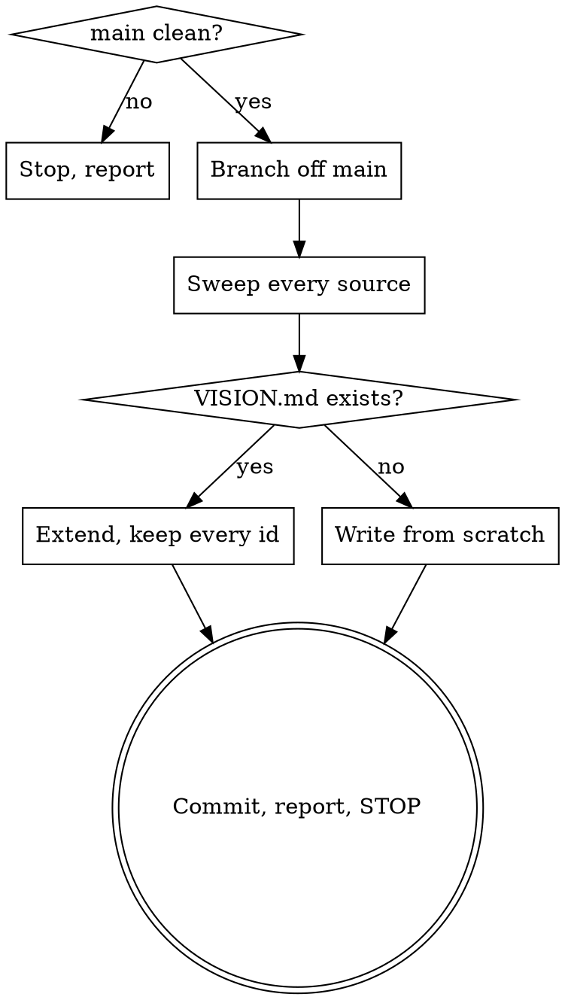

# vision-build

## Overview

Sweeps everything a project says about itself and turns it into `VISION.md`:
one entry per feature, each tagged with where the claim came from and what it
costs if it is wrong, each ending in a blank `A:` only the author fills in.

**The core principle: separate the author's decisions from the assistant's
inferences, permanently.** Documents written by an assistant assert its guesses
in the same confident voice as the author's rulings. Once written they are
enforced by every later session and have to be re-explained during feature
work. This file is where the two voices come apart.

**This command writes exactly one file and touches nothing else.** It does not
edit a document, an issue, or a board. That is `vision-apply`, and it runs only
after the author has answered.

**REQUIRED:** read `~/.claude/skills/vision-build/vision-format.md` before
writing anything. It defines the entry shape, the ids, both tag axes, and what
`[SAID]` requires. Do not work from memory of it.

## Workflow

### 1 · Preflight

Both `vision-build` and `vision-apply` run on their own branch off a clean
`main`.

- `git status --porcelain` must be empty and the checkout on the default branch.
  If it is not, **stop** and say what is dirty. Do not stash, do not commit the
  author's work-in-progress.
- Create `vision/build-YYYY-MM-DD` (or `vision/round-N-...` when extending).
- If the project keeps feature work in worktrees, use one.

### 2 · Sweep every source

Read, do not skim:

| Source | Looking for |
|---|---|
| `CLAUDE.md`, `AGENTS.md`, nested ones | Every normative claim; and lines attributed to the author |
| `README.md`, `docs/**`, specs, ADRs | What the product is claimed to be |
| Issue bodies, comments, titles | Requirements, and the author's own wording |
| The project board, every column | Work that implies a decision nobody wrote down |
| `git log` | Commits **the author wrote** — these are citations |
| Code that encodes a product decision | Magic numbers, thresholds, enum members, defaults |

Dispatch parallel readers if the project is large; they return claims, not file
dumps. **The board is usually not visible to a REST API** — a project using
GitHub Projects v2 needs GraphQL, and concluding "the board can't be read" from
a REST limitation is wrong.

### 3 · Turn claims into entries

**The completeness contract.** The file is finished when each of these holds its
own numbered id and its own **Q**:

- every feature the project describes
- every number the assistant chose — each timeout, cap, weight, curve, limit,
  interval and budget, **counted one by one**
- every mechanism invented to deliver a goal the author stated
- every default, every fallback, every "if it fails, then…"
- every thing the documents forbid
- every word the project uses in a special sense
- every claim two documents make differently

Report the count as `N entries from M source claims`. Two claims share an entry
only when one ruling settles both — never because they are the same *kind* of
thing. Seven constants are seven entries, not one table with one question.

**The file ends with its last entry.** There is no closing section listing what
you judged not worth the author's time. If you found it, it has an id.

**Length is not the author's problem, and the tag pair is why.** The file is
scanned from `[MINE] [BLOCKS]` downward and abandoned wherever the author likes;
they never read it start to finish. Compressing it takes that stopping choice
away from them and makes it yours. An entry they don't care about costs them one
glance at its tags. A claim you filtered out costs them the thing this file
exists to prevent — it stays settled, in your voice, and nobody is ever asked
about it again.

**Tag both axes, and earn `[SAID]`.** Provenance defaults to `[MINE]`; it moves
to `[SAID]` only with a citation written into the entry, and to `[IMPLIED]` only
when you can name what it follows from. Confidence is not evidence. See the
format reference for what counts.

**Write `Q` for the mechanism, never as multiple choice.** Options put your
words in the author's mouth. State what the documents currently claim, then ask
in prose, and expect the answer to go further than any option would have.

### 4 · Extending an existing VISION.md

There is only ever one truth file. If it exists:

- **Never renumber and never reuse an id.** Read the highest `V-` in the file
  and allocate above it.
- Do not rewrite answered entries. An answered `A:` is the author's words.
- Append new entries in a new trailing round section named for what raised them.
- If an existing entry is now wrong, do not edit it — add a new entry that says
  so and cites the old id.

### 5 · Commit and stop

Commit `VISION.md` alone. Then report:

- counts on both axes, and how many are unanswered
- the `[MINE] [BLOCKS]` list by id and title — the ones worth the author's time
- that answers go in the `A:` blocks in the file, and that `vision-apply` is
  the next step and will refuse until they are filled

**Then stop.** Do not open a pull request. Do not begin `vision-apply`. Do not
start implementing anything the file asks about.

## Red flags — stop and re-read the format reference

| Thought | Reality |
|---|---|
| "This is obviously what they want" | Then it is `[MINE]` and cheap for them to confirm. Write the entry. |
| "I'll offer them two options to make it easy" | Options are your words in their mouth. Ask in prose. |
| "They said not to hand them a wall of text" | They said that about reading, and the tag pair already answers it. It is not permission to decide which claims they get asked about. |
| "Asking nine separate questions about numbers is the wall of text" | Nine numbers are nine rulings. One table with one question is one ruling, and eight decisions you kept. |
| "Each of these is a one-line change, so they share an entry" | Cheap to change is `[CHEAP]`, which is a tag, not a merge. Same *kind* is not same ruling. |
| "I'll add a section listing what I left out, so they can pull any back" | That is the triage, written down. The file ends with its last entry. |
| "None of these decides what the project *is*" | You are ruling on which of their decisions matter. That is the judgment the file takes away from you. |
| "The spec states this, so it's `[SAID]`" | The spec was written by an assistant. `[SAID]` needs the author's own words. |
| "I'll fix the docs while I'm in here" | That is `vision-apply`, after answers. |
| "I'll fill in an obvious `A:` to save time" | Only the author writes there. An assistant-written answer is the original failure. |
| "I'll renumber to tidy the gaps" | Ids are cited by anchor. Renumbering silently repoints every citation. |

## Common mistakes

- **Sweeping only the docs.** Constants in code are undocumented decisions, and
  they are where invented numbers hide.
- **Writing `Explain` in jargon.** It is for someone who has not read the code.
- **Prefilling `A:` with "TBD".** `vision-apply` and `vision-check` detect
  unanswered entries by an empty `A:`; a placeholder defeats both.
- **Committing on `main`.** Preflight exists so the whole sweep is one
  reviewable diff.
